# DS Agent

A data-science agent that runs entirely on your own machine. Point it at a folder with a project brief and a dataset, and it reads the brief, writes a plan, works through an exploratory analysis step by step, and hands back the code as a notebook or script. It also writes SQL (including Snowflake), trains and evaluates models, and scaffolds deployment.

It runs on an open-weight model (`gpt-oss:20b`) served by Ollama, behind a FastAPI server with a browser UI. Generated code runs in a locked-down Docker container, and nothing is written to your files without your approval.

## What it does

- **Reads the task before touching the data.** The brief is read in its own terms: its questions word for word, the deliverables, the audiences, constraints, and the data dictionary. When the data has no labelled outcome, the agent says so instead of inventing a target.
- **Plans, then explores against the plan.** The plan's questions become an agenda. After every analysis step, a reviewer call records what the step found, with its numbers, against the question it settled, and adds a follow-up question when a result shows something unexpected. The next step is chosen from everything learned so far, not from a fixed checklist.
- **Only reports what it computed.** Before a reply goes out, every number and file name in it is checked against the output of the tools that actually ran, and unsupported statements are removed.
- **Exports reproducible work.** The session's successful analysis steps are exported as an `.ipynb` notebook or a `.py` script, which is first re-run in the sandbox from the source data to prove it executes.
- **Covers the wider workflow.** It can query Snowflake, Postgres, BigQuery, MySQL and other sources read-only, write SQL against the loaded data and test it locally, train and compare models with leakage-safe validation, and scaffold a FastAPI service, a Dockerfile, and CI/CD.

## Design principles

1. **The model makes judgement calls; code checks facts.** Whether a request needs action, which tools it may use, what the brief asks, and what to do next are decided by the model reading the request, the brief and the data, never by keyword rules. Deterministic code handles what can be checked: whether a column can serve as a label, whether a number appears in real output, whether a write was approved.
2. **One agent with shared state by default.** A data-science task is a chain where each step depends on the previous one. An earlier five-specialist design lost context at every handoff and was slower, so a single agent keeping the whole trace is the default, with the multi-agent orchestrator kept behind a switch.
3. **Evidence over fluency.** A missing number is better than an invented one. Claims are checked against tool output, and failures are reported as failures, never smoothed over.
4. **Nothing irreversible without a person.** File writes are proposals until approved, data sources are read-only, and generated code has no network and no access to your folders.
5. **Measure before and after every change.** An evaluation suite with known answers is run before and after changes, and the unit tests pin down each failure that has been fixed.

## How it works

```mermaid
flowchart TD
    UI["Browser UI"] --> API["FastAPI server: background jobs with live progress"]
    API --> INTENT["1. Interpret the request<br/>answer, act or clarify; allowed tools; plan first?"]
    INTENT -->|answer| REPLY
    INTENT -->|act| BRIEF["2. Read the brief<br/>questions, deliverables, audiences, task type, target"]
    BRIEF --> PLAN["3. Write the plan<br/>its EDA questions become the agenda"]
    PLAN --> LOOP["4. Tool loop<br/>the model calls tools natively"]
    LOOP --> TOOLS["27 tools: profiling, custom analysis,<br/>SQL, training, export, deployment"]
    TOOLS --> SANDBOX["Docker sandbox for generated code<br/>no network, read-only inputs"]
    TOOLS --> CRITIC["Critic: records the finding with its numbers,<br/>marks agenda items answered, adds follow-ups"]
    CRITIC --> LOOP
    LOOP --> CHECK["5. Evidence check<br/>numbers and files must appear in tool output"]
    CHECK --> REPLY["Reply: the plan, the results by brief question,<br/>and which agenda questions are still open"]
    TOOLS -. proposed writes .-> APPROVE["Pending changes: you approve or reject"]
```



Each request is handled in five stages:

1. **Interpretation.** A single model call reads the request with the conversation and the brief, and returns a structured decision: answer, act or clarify, the tools the request needs, and whether the work should be planned first. If the model backend is unreachable, the reply says so rather than treating it as an unclear request.
2. **Brief reading.** One call extracts the brief's objective, questions, deliverables, audiences, constraints and data dictionary. Data checks then reject a proposed target that is a date, an identifier or a constant.
3. **Planning.** The plan maps each brief question to the columns and analyses that serve it, and lists independent data checks. These become an agenda with open and answered items, which is revised once the exploration is done.
4. **Exploration.** The model writes its own pandas code, which runs in the sandbox. Tables carry over between steps, so each step builds on the last. A critic call after every step records what was found and updates the agenda.
5. **Reply.** Unsupported statements are removed. The reply shows the stored plan, the results organised by the brief's questions, and how many agenda questions were answered.

The full design, including every tool, the memory layers and the reasons behind each decision, is in [AGENT_ARCHITECTURE.md](AGENT_ARCHITECTURE.md).

## Safety model

| Risk | Control |
| --- | --- |
| Generated code damaging the machine | Runs in a Docker container with no network, a read-only root file system, all Linux capabilities dropped, a non-root user, and memory and process limits. Your folders are never mounted; data goes in as a read-only copy. There is no host-execution fallback. |
| Unwanted file changes | Every write, edit and generated file is staged in the Pending changes panel with its diff. Only approved changes are applied, the agent never creates folders unasked, and there is no delete tool. |
| Destructive database queries | The SQL tools refuse statements that change data or permissions (INSERT, UPDATE, DELETE, DROP, ALTER, GRANT and others) before they reach the database. Use a read-only database role as well in shared deployments. |
| Leaked credentials | Passwords and keys are read from environment variables only. If the model passes a secret in connector settings, it is dropped before the connector sees it. |
| A request turning into unrequested work | Each request gets an allowed-tool list from its interpretation, and a tool outside that list does not run. Tools with side effects get an extra check against the user's instructions. |
| Invented results | The evidence check described above, plus a reply footer listing failed steps and files that are not yet saved. |

## Evaluation

`evals/` holds an evaluation harness with cases whose right answers are known. The synthetic cases plant signals in seeded data, for example a provider that bills five service lines per visit or prices 1.6 times its peers, and compute the true values from the data. Scores are kept separate because each kind fails for a different reason:

- **Understanding:** task type, target, the brief's questions and audiences.
- **Findings:** whether the planted entities are named, and whether the key numbers are stated within tolerance.
- **Process:** steps that succeeded, statements removed for lacking evidence, whether exported code re-runs, whether any file was touched without approval, time, and model calls.

An intent suite checks how requests are interpreted, including requests about earlier work in a fresh session (where asking is right) and after an analysis (where acting is right).

Latest results with `gpt-oss:20b` on an M1 Pro (32 GB), October 2026:

| Check | Result |
| --- | --- |
| Intent suite (15 requests) | 15 of 15 correct, in each of two runs |
| Brief understanding, synthetic cases | 1.00 on both cases (task type, target, every question and audience) |
| Unit tests | 1,386 passing, 82.7% line coverage |

```bash
.venv/bin/python -m evals.run_eval --stage intent      # about 15 minutes
.venv/bin/python -m evals.run_eval --stage understand  # about 2 minutes per case
.venv/bin/python -m evals.run_eval --stage full --cases synthetic_claims
.venv/bin/python -m evals.run_eval --compare evals/results/<old>/results.json evals/results/<new>/results.json
```

Add `--backend claude` to run the same suite on the hosted model for comparison. Results are written to `evals/results/`, which is not tracked.

## Quick start

Requirements: macOS on Apple Silicon or Linux, Python 3.11, [Ollama](https://ollama.com), Docker, and about 32 GB of memory for the default model.

```bash
# 1. Models
ollama pull gpt-oss:20b
ollama pull nomic-embed-text

# 2. Python environment
python3.11 -m venv .venv
source .venv/bin/activate
pip install -e ".[dev]"

# 3. Sandbox image for generated code
docker build -f docker/sandbox.Dockerfile -t ds-agent-sandbox:local .

# 4. Settings (only the Ollama entries are needed for local use)
cp .env.example .env

# 5. Run (with `ollama serve` running in another terminal)
python -m uvicorn agent.api.server:app --port 9090
```

Open http://localhost:9090 and set a working directory that contains your data and brief. `curl -s localhost:9090/health` should report `llm.available: true`.

### Using it

- **Requests are plain English**, for example "Read the brief, plan the work and complete the EDA", "Write the Snowflake SQL for total paid per provider", or "Export the analysis as a Python script".
- **The Writes switch** next to Send is off by default, so changes are shown as diffs only. With it on, changes are staged for approval, never applied unattended.
- **The Multi-agent switch** is off by default; turn it on only for work that splits into independent strands.
- **Pending changes** are applied or discarded from the panel, or through `GET /chat/sessions/{sid}/pending` and `POST /chat/sessions/{sid}/pending/apply` or `/discard` with `{"ids": [...]}`.

## Configuration

Settings are read from the environment or `.env`. The most useful ones:

| Variable | Default | Effect |
| --- | --- | --- |
| `USE_CLAUDE` | `no` | `yes` sends requests to the Anthropic API instead of the local model (needs `ANTHROPIC_API_KEY`; your data then leaves the machine). |
| `DSAGENT_SCOPE_MODEL` | `gpt-oss:20b` | Local chat model served by Ollama. |
| `DSAGENT_MULTIAGENT` | `0` | `1` makes the multi-agent orchestrator the default. |
| `DSAGENT_AGENT_STEPS` | `24` | Tool-call budget for one request. |
| `DSAGENT_JOB_TIMEOUT_S` | `900` | Time budget for one request. |
| `DSAGENT_ALLOW_WRITES` | `0` | Server default for the Writes switch. |
| `DSAGENT_CRITIC` | `1` | The per-step critic that records findings. |
| `DSAGENT_NUM_CTX` | `65536` | Context window. |
| `DSAGENT_TRACE_DIR` | unset | When set, every model call is recorded to JSONL for debugging and analysis. |
| `DSAGENT_STATE_DIR` | `~/.ds-agent` | Local session store, memory, MLflow records and DVC data. |

Token budgets for individual calls (`DSAGENT_PLAN_TOKENS`, `DSAGENT_CRITIC_TOKENS` and others) are documented in [AGENT_ARCHITECTURE.md](AGENT_ARCHITECTURE.md).

## Development

```bash
pytest -q                     # unit and integration tests, 80% coverage gate
ruff check .                  # lint
mypy agent/ --ignore-missing-imports
dvc repro                     # reproducible demonstration pipeline on a synthetic fixture
```

- **CI** (`.github/workflows/ci.yml`) runs lint, type checks, the tests, the DVC pipeline and schema validation on pull requests that change code or configuration.
- **CD** (`cd.yml`) repeats those checks on `main`, runs the integration tests, and builds the sandbox image. It never pushes an image, so the repository holds no registry credentials.
- **Retrain** (`retrain.yml`) runs weekly: drift detection, `dvc repro`, and an MLflow gate that promotes a challenger model only if it beats the current one by a set margin (`METRIC_GATE_MARGIN`, default 0.01).

### Deploying a trained model

The `deploy_model` tool packages a trained model as a FastAPI prediction service in a `deploy/` folder of your working directory (`app.py`, `Dockerfile`, `requirements.txt` and the serialised model), staged for your approval. To publish that service image to your own registry, build and push it from your machine with a token held outside the repository:

```bash
cd deploy
docker build -t ghcr.io/<your-user>/<model-service>:latest .
echo "$GHCR_TOKEN" | docker login ghcr.io -u <your-user> --password-stdin
docker push ghcr.io/<your-user>/<model-service>:latest
```

## Project layout

```
agent/
  api/            FastAPI server, request interpretation, agent loop, tools,
                  Docker sandbox, brief reading, evidence check, call tracing
  pipeline/       ETL, EDA, feature engineering, model training and evaluation
  connectors/     Read-only connectors: Snowflake, Postgres, BigQuery, MySQL, and others
  memory/         SQLite session store, ChromaDB long-term memory, schema cache
  monitoring/     Drift detection and feedback
evals/            Evaluation cases with known answers, scoring, and the runner
tests/            Unit and integration tests
deploy/           MLflow metric gate
docker/           Sandbox image
.github/workflows CI, CD and the weekly retrain job
```

## Limitations

- **Speed:** a full brief-to-EDA request takes about 15 minutes on the local 20B model, most of it spent waiting on the model.
- **Analysis depth:** the local model reliably finds strong planted patterns but can miss subtler ones. The hosted backend is available for comparison.
- **The evidence check is numeric:** statements without numbers are not checked against output, and small whole numbers (up to 20) are skipped because they are usually counts.
- **Docker is required** for any custom analysis code; without it the agent reports that code cannot run, rather than running it on the host.
